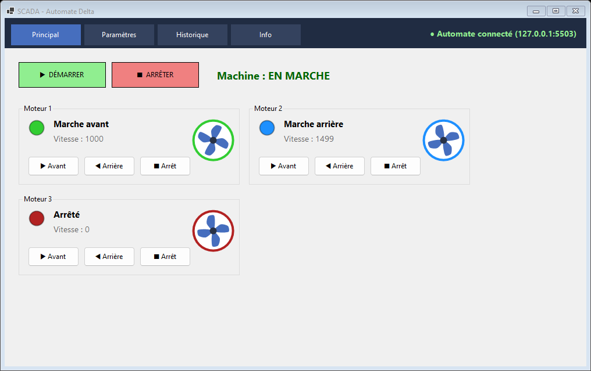

# Scada_app_for_plc

Application **SCADA** pour automate programmable industriel (API) **Delta**, écrite en C# (.NET 10, WinForms).

Elle supervise et pilote trois moteurs par **Modbus**, archive les vitesses mesurées dans **PostgreSQL** et les exporte vers **Excel**. Le projet suit le cours *Create Your Own SCADA for PLC with C# Language* (IUC, CS2I, EADL-1).



*Écran principal, branché sur un automate simulé : les hélices tournent à la vitesse réelle et dans le sens du moteur.*

## Ce que fait l'application

| Page | Rôle |
|---|---|
| **Principal** | Démarrer / arrêter la machine, piloter chaque moteur (avant, arrière, arrêt). Voyant d'état, hélice animée et vitesse réelle pour chaque moteur. |
| **Paramètres** | Écrire les consignes de vitesse dans l'automate, lire les mesures, enregistrer une mesure en base. |
| **Historique** | Afficher les dernières mesures stockées dans PostgreSQL et les exporter en `.xlsx`. |
| **Info** | Afficher la configuration active (sans le mot de passe). |

L'application démarre même sans automate ni base de données : la liaison est retentée toutes les 3 s, et les erreurs s'affichent en bas de chaque page.

## Comment ça marche, en bref

L'automate expose une mémoire faite de **cases** que le PC lit et écrit par le réseau :

- les cases **M** valent 0 ou 1. Ce sont des interrupteurs : « moteur 1 en avant ? », « machine autorisée ? » ;
- les cases **D** contiennent un nombre : la vitesse demandée (**consigne**) ou la vitesse réelle (**mesure**).

Un clic sur un bouton écrit dans une case. Le programme Ladder de l'automate lit cette case, commande le moteur, et écrit la vitesse réelle dans une autre case, que l'application relit toutes les 100 ms pour animer l'écran.

### Table des adresses

À reproduire dans le programme Ladder de l'automate.

| Adresse | Sens | Rôle |
|---|---|---|
| `M0` / `M1` | PC → automate | Moteur 1 : avant / arrière |
| `M2` / `M3` | PC → automate | Moteur 2 : avant / arrière |
| `M4` / `M5` | PC → automate | Moteur 3 : avant / arrière |
| `M20` | PC → automate | Marche machine (boutons Démarrer / Arrêter) |
| `D3000` à `D3002` | PC → automate | Consignes de vitesse des moteurs 1 à 3 |
| `D3100` à `D3102` | automate → PC | Vitesses réelles des moteurs 1 à 3 |

Les numéros sont modifiables dans `appsettings.json`. Delta réserve certaines zones (par exemple `D1000` à `D1999`) : évite-les.

## Démarrage rapide

**Prérequis** : Windows, [SDK .NET 10](https://dotnet.microsoft.com/download), PostgreSQL, Visual Studio compatible .NET 10 (facultatif).

```bash
git clone https://github.com/Corei913th/Scada_app_for_plc.git
cd Scada_app_for_plc
```

1. **Créer la base** :
   ```bash
   psql -U postgres -f database/create_scada_db.sql
   ```
2. **Créer ta configuration locale** : copie `Scada_App_For_plc/appsettings.example.json` en `Scada_App_For_plc/appsettings.json`, puis remplace `CHANGE_ME` par ton mot de passe PostgreSQL. Ce fichier est ignoré par git.
3. **Choisir la cible** (voir ci-dessous) en ne gardant qu'un bloc de configuration actif.
4. **Lancer** depuis Visual Studio (F5) ou :
   ```bash
   dotnet run --project Scada_App_For_plc
   ```

## Choisir la cible : trois configurations

Le même programme peut parler à trois cibles. Il suffit de régler la section `Plc` de `appsettings.json`.

| Cible | `Ip` | `Port` | `Protocol` | `CoilOffset` | `RegisterOffset` |
|---|---|---|---|---|---|
| Simulateur d'ISPSoft (COMMGR, « DVP Simulator ») | `127.0.0.1` | `10002` | `AsciiOverTcp` | `2048` | `4096` |
| `PlcSimulator` (faux automate de ce dépôt) | `127.0.0.1` | `502` | `Tcp` | `0` | `0` |
| Vrai automate Ethernet (ex. AS218PX) | IP de l'automate, par ex. `192.168.0.1` | `502` | `Tcp` | selon le manuel de la gamme | selon le manuel de la gamme |

- **`Protocol`** : `Tcp` pour le Modbus TCP classique, `AsciiOverTcp` pour le Modbus ASCII transporté sur TCP, que parle le simulateur d'ISPSoft.
- **`CoilOffset` / `RegisterOffset`** : adresse Modbus de `M0` et de `D0`. Elle dépend de la gamme d'automate (sur la série DVP, `M0` = 2048 et `D0` = 4096). Vérifie la table de correspondance du manuel Delta de ton modèle.

### Brancher le simulateur d'ISPSoft

1. Dans ISPSoft, ouvre ton projet et démarre le simulateur (COMMGR, driver « DVP Simulator »), puis passe en **RUN**.
2. Le champ **Device** du driver dans COMMGR doit correspondre au modèle du projet ISPSoft (SE, SV, etc.), sinon un avertissement « model do not match » s'affiche. Il est sans gravité.
3. Lance l'application : les clics écrivent dans les vraies cases du simulateur, et ton programme Ladder y réagit.

Le simulateur n'invente rien : sans programme Ladder qui écrit la vitesse réelle dans `D3100` et suivantes, les voyants changent mais les mesures restent à 0.

## Tester sans ISPSoft ni automate : `PlcSimulator`

Le dossier `PlcSimulator/` contient un faux automate Modbus TCP qui reproduit la logique attendue : il coupe les moteurs quand `M20` vaut 0, interdit avant et arrière en même temps, et fait monter la vitesse vers la consigne avec de l'inertie.

```bash
dotnet run --project PlcSimulator          # écoute sur 127.0.0.1:502
dotnet run --project PlcSimulator -- 5020  # ou sur un autre port
```

Sa console affiche un lexique, l'état en direct de l'automate et un journal en français de ce que le SCADA vient d'écrire. C'est l'outil idéal pour comprendre ce que chaque clic provoque. Il valide l'application, pas ton programme Ladder.

## Programme Ladder minimal (ISPSoft)

```
Moteur 1 avant  : M0 · M20 · /M1  → Y0
Moteur 1 arrière: M1 · M20 · /M0  → Y1
Moteur 2 avant  : M2 · M20 · /M3  → Y2
Moteur 2 arrière: M3 · M20 · /M2  → Y3
Moteur 3 avant  : M4 · M20 · /M5  → Y4
Moteur 3 arrière: M5 · M20 · /M4  → Y5

Toujours ON (M1000 sur DVP-SE) :  MOV D3000 D3100
                                  MOV D3001 D3101
                                  MOV D3002 D3102
```

Les contacts `/Mx` (normalement fermés) verrouillent le sens opposé. Sans le contact `M20`, l'arrêt machine coupe tous les moteurs. Les `MOV` renvoient la consigne comme « mesure » : remplace-les par ta vraie mesure de vitesse.

## Architecture

```
Form1 (navigation + état de la liaison)
 └─ Views/   MainView · ParametresView · HistoriqueView · InfoView
             MotorPanel (carte moteur) · Rotor (hélice animée) · Led · ViewBase
     └─ Services/  AppServices ─┬─ PlcService         NModbus : Modbus TCP ou ASCII sur TCP
                                ├─ MesureRepository   Npgsql : requêtes paramétrées
                                └─ ExcelExporter      ClosedXML : sans Excel installé
AppSettings ← appsettings.json
```

| Dossier | Contenu |
|---|---|
| `Scada_App_For_plc/` | L'application WinForms |
| `PlcSimulator/` | Faux automate Modbus TCP pour les tests |
| `database/` | Script SQL de création de la base `scada` et de la table `mesures` |
| `docs/` | Captures d'écran |

Toutes les vues sont construites dans le concepteur de Visual Studio (fichiers `.Designer.cs`). Seule la logique, qui est dynamique, est écrite à la main. Les communications avec l'automate passent par une seule connexion partagée, sérialisée par un verrou.

**Technologies** : .NET 10, WinForms, NModbus 3.0.83, Npgsql 10.0.3, ClosedXML 0.105.1.

## Dépannage

| Symptôme | Piste |
|---|---|
| Voyant « Automate hors ligne » | Vérifie l'IP et le port, que l'automate ou le simulateur est bien en **RUN**, et que `Protocol` correspond à la cible. |
| Connecté, mais les moteurs ne réagissent pas ou les valeurs sont incohérentes | Les offsets `CoilOffset` et `RegisterOffset` ne correspondent pas à ta gamme. Reprends la table du manuel Delta. |
| Les mesures restent à 0 | Le programme Ladder n'écrit rien dans `D3100` et suivantes. |
| Erreur en bas de la page Paramètres ou Historique | Base absente ou mot de passe faux : relance `database/create_scada_db.sql` et vérifie la chaîne de connexion. |
| Avertissement « model do not match » dans COMMGR | Mets dans **Device** le même modèle que dans ton projet ISPSoft. |

## Sécurité de la configuration

`Scada_App_For_plc/appsettings.json` contient le mot de passe PostgreSQL : il est **ignoré par git**. Seul le modèle `appsettings.example.json`, avec `CHANGE_ME`, est suivi. Ne commite jamais un vrai mot de passe.
